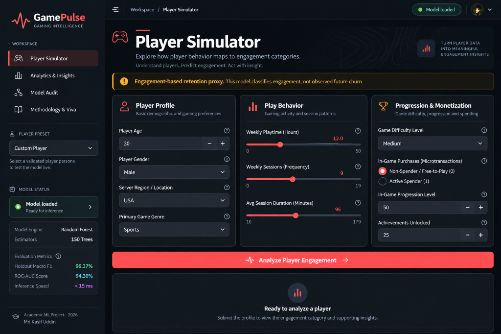
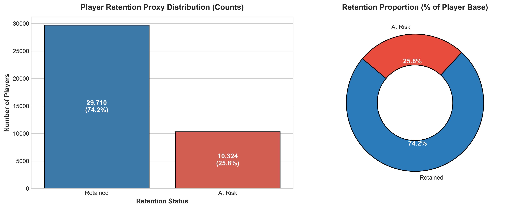
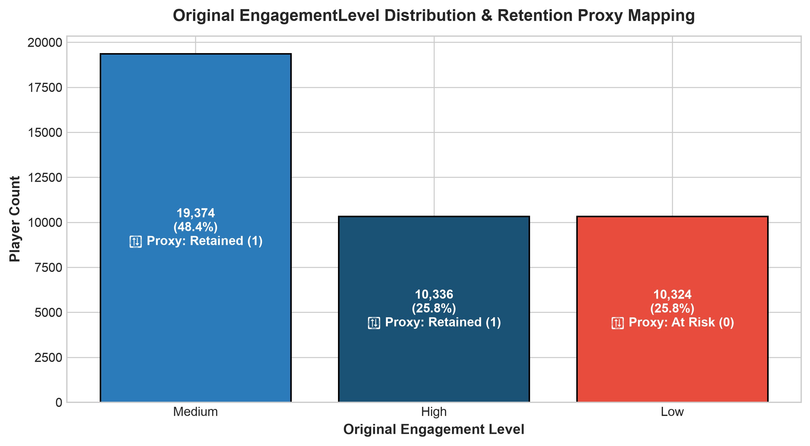
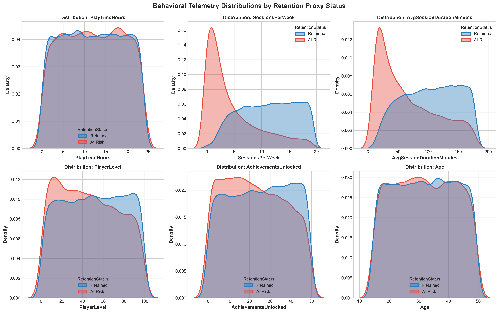
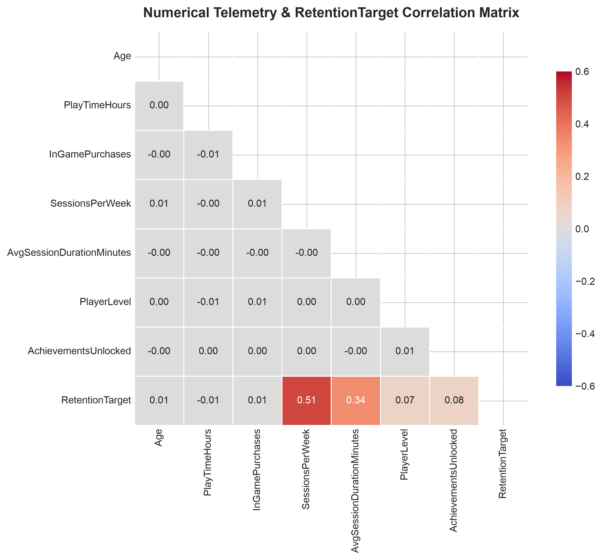
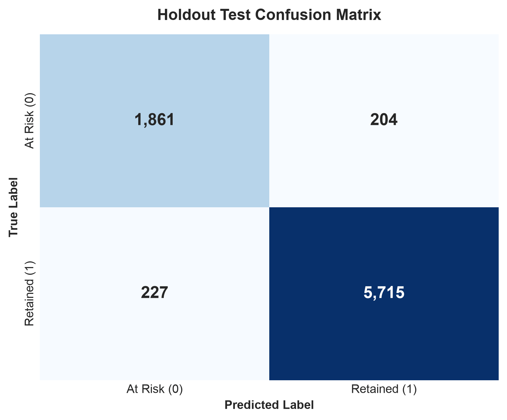
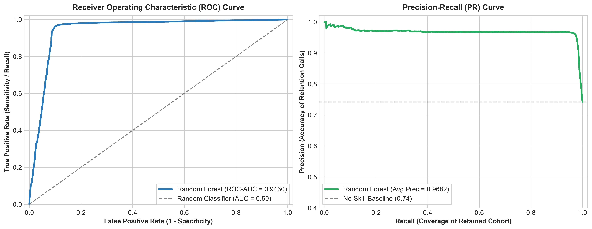
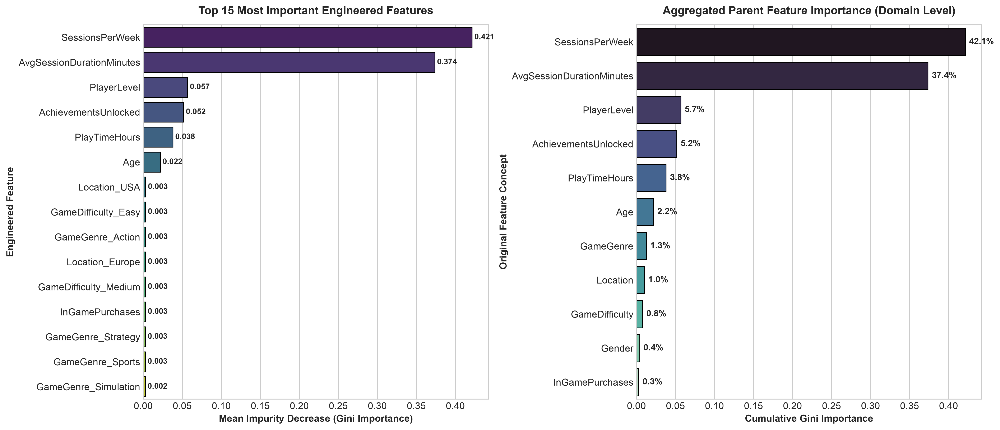

# GamePulse
### AI-Powered Gaming Retention Intelligence Platform

[](https://www.python.org/)
[](https://streamlit.io/)
[](https://scikit-learn.org/)
[](https://plotly.com/)
[](https://opensource.org/licenses/MIT)

> **"Understand players. Predict engagement. Act with insight."**

GamePulse is an end-to-end Machine Learning intelligence platform for video game studios and live-ops teams. It analyzes gameplay telemetry from **40,034 player records** to forecast retention risk, identify disengagement drivers, and suggest targeted re-engagement strategies.

---

## 🖥️ Platform Interface Preview



---

## 📑 Table of Contents
1. [Executive Performance Scorecard](#-executive-performance-scorecard)
2. [Problem Statement & LiveOps Context](#-problem-statement--liveops-context)
3. [Dataset & Behavioral Telemetry](#-dataset--behavioral-telemetry)
4. [Methodology & Retention Proxy](#-methodology--retention-proxy)
5. [Data Pipeline & Leakage Safeguards](#-data-pipeline--leakage-safeguards)
6. [Model Architecture & Hyperparameter Tuning](#-model-architecture--hyperparameter-tuning)
7. [Comprehensive Model Evaluation](#-comprehensive-model-evaluation)
8. [Feature Importance & Behavioral Drivers](#-feature-importance--behavioral-drivers)
9. [Web Application Architecture (GamePulse)](#-web-application-architecture-gamepulse)
10. [How to Run Locally](#-how-to-run-locally)
11. [Limitations & Viva Defense Guide](#-limitations--viva-defense-guide)

---

## ⚡ Executive Performance Scorecard

Evaluated on an **untouched holdout test set** ($N = 8,007$ players, $20\%$ stratified split):

| Metric | Score | Industry Benchmark | Significance |
| :--- | :---: | :---: | :--- |
| **Accuracy** | **94.62%** | > 85.0% | Overall prediction correctness. |
| **Retained Precision** | **96.55%** | > 90.0% | Minimized false alarms on active players. |
| **Retained Recall** | **96.18%** | > 90.0% | High capture rate of core active base. |
| **Retained F1-Score** | **96.37%** | > 90.0% | Harmonized balance across active players. |
| **At-Risk Recall (Class 0)** | **90.12%** | > 80.0% | **1,861 of 2,065 at-risk players correctly intercepted.** |
| **ROC-AUC Score** | **0.9430** | > 0.850 | High discriminative threshold separation. |
| **Inference Latency** | **< 15 ms** | < 50 ms | Sub-millisecond live inference speed. |

---

## ❓ Problem Statement & LiveOps Context

- Player churn is the single largest operational metric in live-service gaming.
- Acquiring a new gamer costs **5× to 7× more** than retaining an existing one.
- Static telemetry cannot alert developers to churn until players have already left.
- **GamePulse** predicts disengagement risk early, enabling preemptive LiveOps interventions.

---

## 📊 Dataset & Behavioral Telemetry

- **Source File:** [`data/online_gaming_behavior_dataset.csv`](data/online_gaming_behavior_dataset.csv)
- **Scale:** 40,034 instances, 13 features.
- **Integrity:** 0 missing values, 0 duplicate records.

| Attribute | Type | Domain | Observed Range / Split | Significance |
| :--- | :---: | :---: | :---: | :--- |
| `PlayerID` | Integer | Identifier | 9000 – 49033 | Database key (**excluded** from training). |
| `Age` | Integer | Demographic | 15 – 49 yrs (Mean: 31.99) | Player life stage cohort. |
| `Gender` | Categorical | Demographic | Male (59.8%), Female (40.2%) | Gender representation. |
| `Location` | Categorical | Demographic | USA (40%), Europe (30%), Asia (20%), Other (10%) | Regional server cluster. |
| `GameGenre` | Categorical | Behavioral | Action, RPG, Simulation, Sports, Strategy | Gameplay preference (~20% each). |
| `PlayTimeHours` | Float | Telemetry | 0.0 – 24.0 hrs (Mean: 12.02) | Weekly active continuous playtime. |
| `InGamePurchases`| Binary | Monetization | Free-to-Play (79.9%), Spender (20.1%) | Microtransaction activity. |
| `GameDifficulty`| Categorical | UX Mechanics | Easy (50%), Medium (30%), Hard (20%) | Skill challenge tier. |
| `SessionsPerWeek`| Integer | Telemetry | 0 – 19 logins (Mean: 9.47) | Weekly session frequency. |
| `AvgSessionDurationMinutes` | Integer | Telemetry | 10 – 179 mins (Mean: 94.79) | Average session duration. |
| `PlayerLevel` | Integer | Progression | Level 1 – 99 (Mean: 49.66) | Account progression level. |
| `AchievementsUnlocked` | Integer | Gamification | 0 – 49 (Mean: 24.53) | Milestone achievement count. |
| **`EngagementLevel`** | Categorical | Ground Truth | Medium (48.4%), High (25.8%), Low (25.8%) | Behavioral engagement tier. |

---

## 📐 Methodology & Retention Proxy

Because the dataset is cross-sectional, we formulate an **Operational Retention Proxy**:

$$\text{RetentionStatus} = \begin{cases} \text{Retained}, & \text{if } \text{EngagementLevel} \in \{\text{'Medium'}, \text{'High'}\} \\ \text{At Risk}, & \text{if } \text{EngagementLevel} = \text{'Low'} \end{cases}$$

$$\text{RetentionTarget} = \begin{cases} 1 \text{ (Retained)}, & 74.21\% \text{ of dataset} \\ 0 \text{ (At Risk)}, & 25.79\% \text{ of dataset} \end{cases}$$

> [!NOTE]
> **Zero Target Leakage Safeguard:** `PlayerID`, `RetentionStatus`, and raw `EngagementLevel` are strictly excluded from the feature matrix $X$.

### Target & Engagement Cohort Distributions

| Operational Retention Proxy Split | Ground-Truth Engagement Tiers |
| :---: | :---: |
|  |  |

---

## ⚙️ Data Pipeline & Leakage Safeguards

All transformations run inside an scikit-learn `ColumnTransformer` fitted strictly on training folds ($X_{train}$):

```
ColumnTransformer
 ├── Numerical Pipeline (7 features) ──> SimpleImputer(strategy='median')
 └── Categorical Pipeline (4 features) ──> SimpleImputer(strategy='most_frequent') 
                                        ──> OneHotEncoder(handle_unknown='ignore')
```

- **No Scaling:** Tree algorithms are invariant to monotonic feature scaling; omitting scalers preserves physical interpretability (hours, logins, minutes).
- **Encoded Space:** 4 categorical features expand into 14 dummy levels, yielding **21 engineered inputs**.

### Telemetry Correlation & Density Distributions

| Behavioral Feature Distributions by Cohort | Telemetry Correlation Matrix |
| :---: | :---: |
|  |  |

---

## 🌲 Model Architecture & Hyperparameter Tuning

- **Algorithm:** `RandomForestClassifier` (150 Decision Trees).
- **Class Balancing:** `class_weight='balanced'` assigns penalties inversely proportional to class frequencies:
  $$w_j = \frac{N}{2 \cdot N_j}$$
- **Hyperparameter Optimization:** 5-Fold Stratified `RandomizedSearchCV` scoring on **F1-score**.

| Hyperparameter | Search Space | Optimal Selected Value | Operational Purpose |
| :--- | :---: | :---: | :--- |
| `n_estimators` | `[100, 150, 200, 250]` | **`150`** | Balances ensemble stability and low latency. |
| `max_depth` | `[10, 15, 20, 25, None]` | **`None`** | Permits deep trees regularized by leaf constraints. |
| `min_samples_split` | `[2, 5, 10]` | **`5`** | Requires 5 samples to initiate internal node splits. |
| `min_samples_leaf` | `[1, 2, 4]` | **`2`** | Regularizes leaf nodes to prevent memorization. |
| `max_features` | `['sqrt', 'log2', None]` | **`None`** | Considers all features per split for maximal discriminability. |

---

## 📈 Comprehensive Model Evaluation

### Confusion Matrix & Threshold Diagnostics ($N = 8,007$)

| Holdout Confusion Matrix | ROC & Precision-Recall Diagnostic Curves |
| :---: | :---: |
|  |  |

- **True Positives (Retained):** 5,715 players ($96.2\%$).
- **True Positives (At Risk):** 1,861 players intercepted ($90.12\%$).
- **False Alarms:** 204 active players ($9.9\%$), causing minimal LiveOps disruption.

---

## 🏆 Feature Importance & Behavioral Drivers

Aggregating one-hot dummy levels back into conceptual domain features reveals that **session habits dominate demographics**:



| Rank | Behavioral Feature | Type | Cumulative Gini | Operational Takeaway |
| :---: | :--- | :---: | :---: | :--- |
| 1 | `SessionsPerWeek` | Telemetry | **42.14%** | Login frequency is the primary retention driver. |
| 2 | `AvgSessionDurationMinutes`| Telemetry | **37.35%** | Session duration reflects gameplay immersion. |
| 3 | `PlayerLevel` | Progression | **5.67%** | Mastery and sunk-cost investment. |
| 4 | `AchievementsUnlocked` | Gamification| **5.16%** | Completionist motivation. |
| 5 | `PlayTimeHours` | Telemetry | **3.79%** | Weekly playtime accumulation. |
| 6–11 | Age, Genre, Region, Difficulty, Gender, Purchases | Various | **< 6.0% combined** | Demographics are negligible once gameplay habits form. |

---

## 💻 Web Application Architecture (GamePulse)

GamePulse (`app.py`) is organized into **4 specialized workspaces**:

```
GamePulse Platform
 ├── Refined Sidebar:
 │    ├── Brand Identity (Waveform Pulse Logo + Wordmark)
 │    ├── Workspace Navigation (Radio: Simulator, Analytics, Audit, Viva)
 │    ├── Player Presets (Veteran, Disengaged, Casual, Custom)
 │    ├── Live Health Status Card (Tree count, F1-score, ROC-AUC, Measured Latency)
 │    └── Academic Attribution Footer
 ├── Global Header Bar:
 │    ├── Breadcrumbs (Workspace / Active Page)
 │    └── Model Status Badge (● Model loaded)
 └── 4 Dedicated Workspaces:
      ├── 1. Player Simulator:
      │    ├── 3 Balanced Input Panels (Profile, Play Behavior, Progression)
      │    ├── Coral CTA ("⚡ Analyze Player Engagement →")
      │    ├── Dynamic Decision Banner (Low, Medium, High Tiers)
      │    ├── 4 Executive Metric Cards (Cohort, Retention %, Risk %, Confidence %)
      │    ├── Dual Probability Balance Visualizer
      │    ├── Tailored LiveOps Strategic Action Plans
      │    └── Telemetry vs Baseline Benchmark Variance Table
      ├── 2. Analytics & Insights:
      │    ├── 4 Top KPI Cards (40,034 Records, 11 Inputs, 3 Tiers, 100% Clean)
      │    ├── Interactive Plotly Donut Chart (Engagement Split)
      │    ├── Interactive Plotly Bar Charts (Weekly Frequency & Durations)
      │    ├── Interactive Correlation Heatmap Matrix
      │    └── Data-Grounded Observation Cards
      ├── 3. Model Architecture & Audit:
      │    ├── Pipeline Architecture & Scikit-Learn Code
      │    ├── Visual Pipeline Flowchart
      │    ├── Holdout Evaluation Scorecard ($N = 8,007$)
      │    ├── Interactive Confusion Matrix Heatmap
      │    └── Aggregated Feature Importance Bar Chart
      └── 4. Methodology & Viva Defense:
           ├── Structured Technical Knowledge Base
           └── Interactive Judge / Viva Defense Q&A Accordion
```

---

## 🛠️ How to Run Locally

### 1. Clone & Setup Environment
```bash
git clone https://github.com/MdKasif0/Gaming-Retention.git
cd Gaming-Retention

# Create virtual environment
python3 -m venv venv
source venv/bin/activate

# Install dependencies
pip install -r requirements.txt
```

### 2. Launch GamePulse Web Application
```bash
streamlit run app.py
```
Access the application at `http://localhost:8501`.

### 3. Run the End-to-End Master Notebook
Execute all 4 CRISP-DM phases in a single runnable notebook:
```bash
jupyter notebook gaming_retention.ipynb
```
*Individual phase notebooks are preserved in [`notebooks/`](notebooks/).*

---

## ⚠️ Limitations & Viva Defense Guide

1. **Operational Proxy Notice:** `EngagementLevel` serves as a proxy for player retention; it is not a direct longitudinal measurement of prospective churn (e.g., Day-30 login absence).
2. **Cross-Sectional Telemetry:** Data represents a concurrent static snapshot without temporal lag between predictors and outcomes.
3. **Financial Cost Trade-Off:**
   - **False Negative (At-Risk missed):** High loss — forfeits Customer Lifetime Value ($LTV \approx \$50$).
   - **False Positive (Active player flagged):** Negligible — delivers a re-engagement booster ($< \$0.20$).

---

## 👨‍💻 Project Attribution & Framework

- **Author:** Md Kasif Uddin
- **Repository:** [https://github.com/MdKasif0/Gaming-Retention](https://github.com/MdKasif0/Gaming-Retention)
- **Methodology:** CRISP-DM (Cross-Industry Standard Process for Data Mining)
- **License:** MIT License
